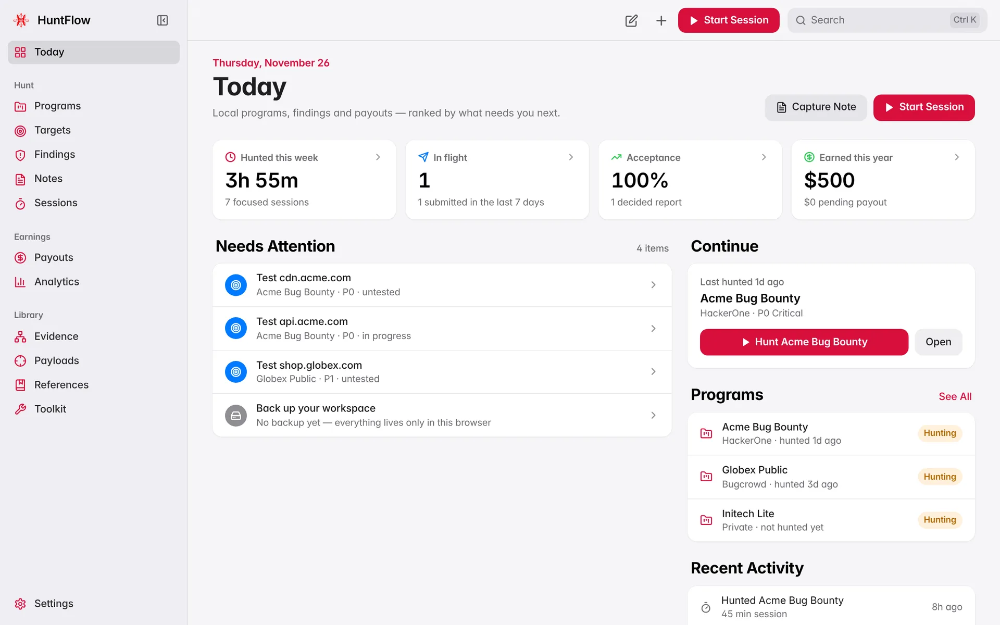
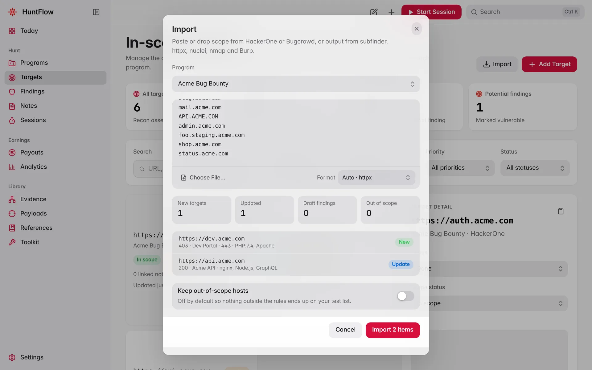
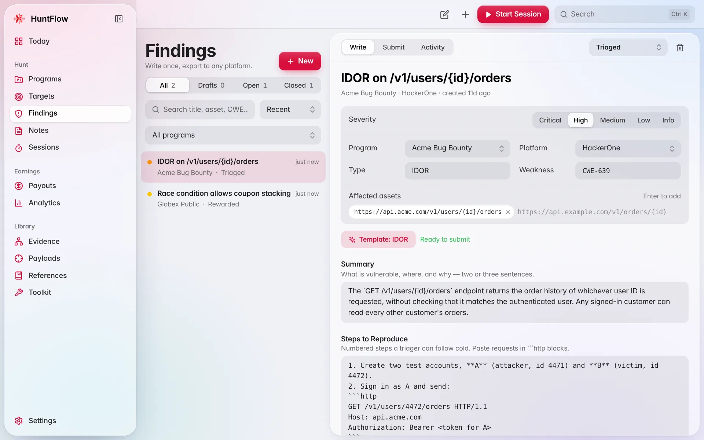
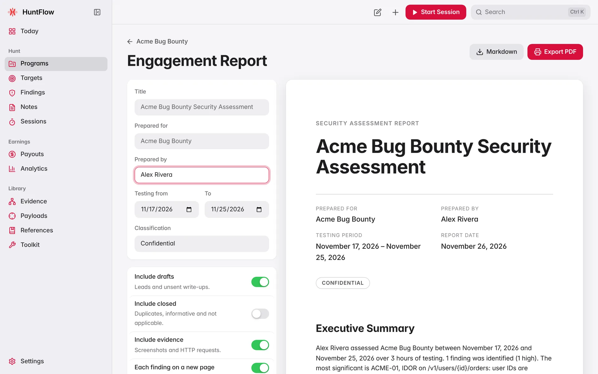

<p align="center">
  
</p>

<h1 align="center">HuntFlow</h1>

<p align="center">
  <strong>Recon to report, in one calm workspace.</strong><br />
  The local-first app for bug bounty hunters and pentesters.
</p>

<p align="center">
  <a href="https://huntflow.xalgorix.com/demo?go=/dashboard">Try the demo</a> ·
  <a href="https://huntflow.xalgorix.com">Website</a> ·
  <a href="https://www.npmjs.com/package/huntflow">npm</a>
</p>

<p align="center">
  
</p>

## Quick start

```bash
npx huntflow
```

This opens HuntFlow at `http://localhost:3000`. No account, no telemetry, and it works offline. Your data stays in your browser, and while HuntFlow runs from this command it also writes rotating backups to `~/.huntflow/backups`.

Prefer not to install anything? [Open the web app](https://huntflow.xalgorix.com/dashboard) or [try it with sample data](https://huntflow.xalgorix.com/demo?go=/dashboard).

## What it does

**Bring scope and recon in.** Import a HackerOne scope CSV or paste a Bugcrowd or Intigriti scope table. Add output from subfinder, amass, httpx, nmap, nuclei or Burp Suite. Every host is checked against the program's rules first, so out-of-scope assets never reach your test list. Duplicates are merged, and nuclei and Burp results become draft findings with the request and response attached.

**Write reports triage accepts.** Start from one of 29 finding templates, score with CVSS 3.1 or 4.0, paste raw requests or curl commands as evidence, and get warned about likely duplicates. Then copy each field straight into the HackerOne, Bugcrowd, Intigriti or YesWeHack form, or export Markdown or PDF.

**Deliver like a pro.** Each program has an engagement report: a cover page, an executive summary written from your findings, scope, a findings overview, and every finding with its evidence. Export it as a clean PDF or as Markdown.

**Stay on top of it.** The Today view shows what needs you next: overdue triage, unfinished drafts, bounties to record, untested targets and backups. Time-boxed sessions show where your hours go. Payouts are tracked by program and platform, with a year-end export for taxes.

| Import scope and recon | Findings | Engagement report |
| --- | --- | --- |
|  |  |  |

## Pipe your tools in

While HuntFlow runs from `npx huntflow`, you can send tool output straight from your terminal:

```bash
subfinder -d acme.com -silent | huntflow push -P acme
httpx -l hosts.txt -json | huntflow push --tee -P acme
nuclei -l urls.txt -jsonl | huntflow push -P acme
nmap -sV -oX - acme.com | huntflow push -P acme
huntflow push scope.csv -P acme          # HackerOne "Download CSV"
```

The output shows up in HuntFlow for review with the program already selected. Nothing is added until you confirm the preview. If HuntFlow isn't running, the output is queued and waiting the next time you start it. You can also paste or drop the same files on the Targets page with **Import**.

| Format | How to produce it |
| --- | --- |
| HackerOne scope | Program → Scope → **Download CSV** |
| Bugcrowd / Intigriti scope | Copy the in-scope and out-of-scope tables |
| subfinder / amass | `subfinder -d acme.com -oJ` or any host list |
| httpx | `httpx -json` or default output |
| nuclei | `nuclei -jsonl` |
| nmap | `nmap -sV -oX scan.xml` |
| Burp Suite | Issues → Report selected issues → XML |

## Your data

- **Local first.** Everything lives in IndexedDB in your browser, on your machine. Nothing phones home.
- **Backed up.** Running from `npx huntflow` mirrors backups to disk (`--backup-dir`, `--keep`). You can also download a full backup from Settings at any time.
- **Optional sync.** HuntFlow Pro syncs your workspace and evidence files across the devices you sign in on. Synced data is encrypted in transit and at rest and is readable only by your account. Everything else is free and works without an account.

## CLI

```text
huntflow [options]          Start HuntFlow
  -p, --port <number>       Port (default 3000)
      --host <address>      Interface to listen on (use 127.0.0.1 to stay off your network)
      --backup-dir <dir>    Where backups are written (default ~/.huntflow/backups)
      --keep=<n>            Backups to keep (default 30)
      --no-backup           Don't write backups to disk
      --no-open             Don't open a browser

huntflow push [file] [options]
  -P, --program <name>      Program to import into (name or part of it)
  -f, --format <format>     h1-scope-csv, scope-text, hosts, httpx, nuclei, nmap, burp
      --tee                 Also print the input
```

## Development

```bash
npm install
npm run dev        # http://localhost:5173
npm test           # unit tests (vitest)
npm run build      # static build used by the CLI
```

HuntFlow is built with SvelteKit and Tailwind CSS, stores data in IndexedDB, and ships as a static app served by a small Node CLI.

### Hosted site and cloud API

[huntflow.xalgorix.com](https://huntflow.xalgorix.com) runs entirely on Cloudflare:

| Piece | Where |
| --- | --- |
| Static app | Cloudflare Pages (`build/`) |
| API (`/api/*`) | Pages Functions: `functions/api/[[path]].ts` → `server/router.ts` |
| Sync records, entitlements | D1 database `huntflow` (schema in `migrations/`) |
| Evidence files | R2 bucket `huntflow-evidence` |
| Sign-in | Firebase Auth; the API verifies Firebase ID tokens |
| Billing | Dodo Payments checkout, portal and webhook (`/api/webhooks/dodo`) |

```bash
npm run check:server   # type-check the API
npm run cf:migrate     # apply D1 migrations
npm run cf:dev         # app + API locally (put secrets in .dev.vars)
npm run deploy:cf      # build and deploy to production
```

Bindings and public settings live in `wrangler.toml`; secrets (`DODO_API_KEY`, `DODO_WEBHOOK_SIGNING_SECRET`, `RESEND_API_KEY`) are Pages secrets. `.env.cloudflare` holds the public Firebase web config used by `npm run build:cf`.

## License

MIT © 2026 xalgorix. Use HuntFlow only for testing you are authorized to do.
